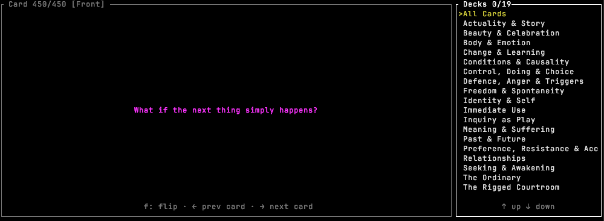

# Awakening Flashcards



A fast, keyboard-driven terminal flashcard application built in Rust using [Ratatui](https://ratatui.rs/) and [Crossterm](https://github.com/crossterm-rs/crossterm).

Designed for focused, distraction-free study sessions directly in your terminal, featuring content inspired by [Discover Awakening Flash Cards](https://1ness.info/Discover_Awakening_Flash_Cards.html).

---

## Features

- **Split-Pane Terminal UI:** A main flashcard viewer (75% width) paired with a category/deck selector sidebar (25% width).
- **Front & Back Card Flipping:** Color-coded front and back views with card position indicators (`Card X/Y [Front|Back]`).
- **Deck & Category Filtering:** Study across **All Cards** or filter by individual decks/categories.
- **Vim-Inspired & Arrow Navigation:** Intuitive keyboard controls with active-pane border highlighting.
- **JSON-Backed Data Store:** Easily extensible flashcard library stored in `./data/cards.json`.

---

## Keyboard Controls

### Global

| Key   | Action                                                    |
| :---- | :-------------------------------------------------------- |
| `Tab` | Switch active focus between **Cards** and **Decks** panes |
| `q`   | Quit the application                                      |

### Flashcard Navigation

| Key       | Action                                   |
| :-------- | :--------------------------------------- |
| `f`       | Flip current card between Front and Back |
| `→` / `l` | Next card                                |
| `←` / `h` | Previous card                            |

### Deck Navigation _(when Decks pane is active)_

| Key       | Action                   |
| :-------- | :----------------------- |
| `↓` / `j` | Next deck / category     |
| `↑` / `k` | Previous deck / category |

---

## Project Structure

```text
awakening-flashcards/
├── Cargo.toml          # Dependencies (ratatui, crossterm, serde, serde_json, anyhow)
├── TODO.md             # Learning roadmap & development milestones
├── data/
│   └── cards.json      # Flashcard categories and card entries
└── src/
    ├── main.rs         # Terminal initialization, render loop, and event polling
    ├── app.rs          # Application state, focus management, and input handling
    ├── models.rs       # Category, Card, and FlashCardData data structures
    ├── data.rs         # JSON deserialization from ./data/cards.json
    └── ui.rs           # Ratatui layout, styling, and widget rendering
```

---

## Data Format

Cards and categories are loaded at startup from `./data/cards.json`:

```json
{
  "categories": [
    {
      "id": 1,
      "title": "Foundations"
    }
  ],
  "cards": [
    {
      "category": 1,
      "prompt": "Front prompt text",
      "text": "Back reflection or explanation text"
    }
  ]
}
```

---

## Getting Started

### Prerequisites

- [Rust & Cargo](https://www.rust-lang.org/tools/install) (2021 or 2024 edition)

### Run the Application

```bash
git clone <your-repo-url>
cd awakening-flashcards
cargo run
```

---

## Roadmap

- [x] Core JSON data models & loader (`serde` + `serde_json`)
- [x] Split-pane Ratatui interface with active pane borders
- [x] Card flipping & sequential card navigation
- [x] Deck filtering & category switching
- [ ] Quick deck selection (`1`–`4` hotkeys)
- [ ] Keyword search across cards
- [ ] Shuffle mode
- [ ] Favourites & favourites-only view
- [ ] Persistent session settings (last deck, card position, and favourites)
